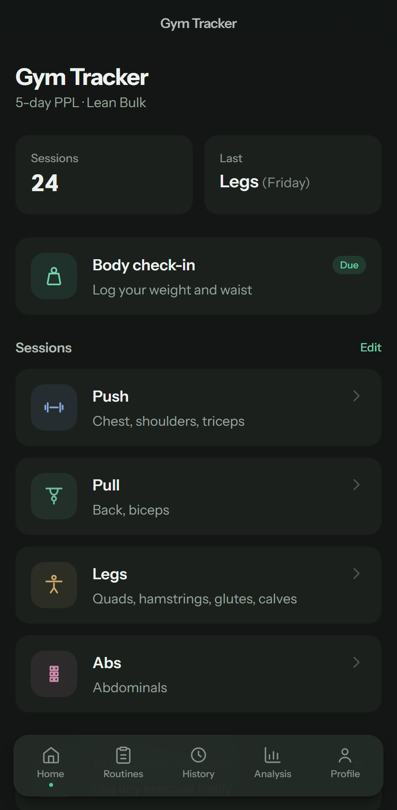
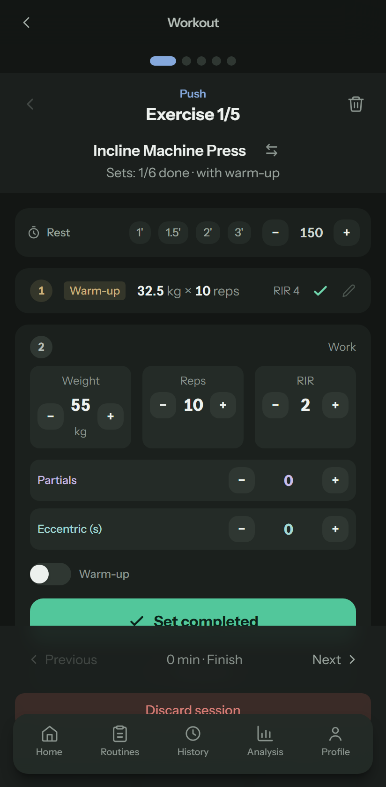
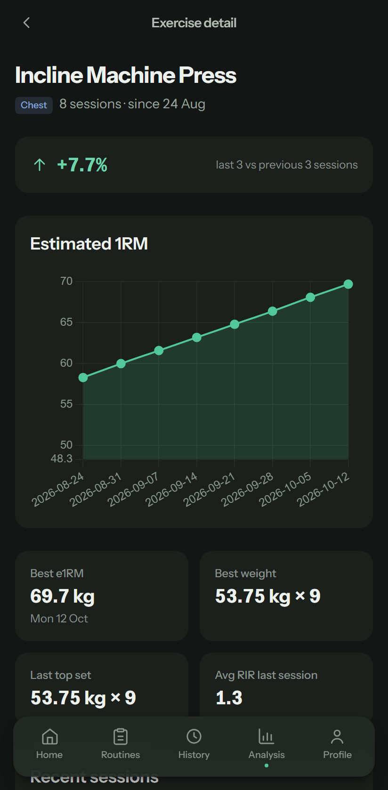

# gym-log

[](https://github.com/pablodiazjorge/gym-log/actions/workflows/ci.yml)

A mobile-first workout tracker built for the gym floor — called **Gym Tracker** inside the app.
Log sets in seconds, get calculated progression targets for your next session, and keep every
byte of your data on your own device.

**Live demo: [gym-log.pablodiazjorge.com](https://gym-log.pablodiazjorge.com/)** — it runs entirely
in your browser, and whatever you log stays in that browser's storage.

## Screenshots

| Home | Logging a set | Exercise progress |
| --- | --- | --- |
|  |  |  |

The screenshots use invented example data; `npm run screenshots` redraws them.

## Features

- **One-tap quick start** — built-in Push / Pull / Legs / Abs days with alternative-exercise
  choices at the start of each session; pin any routine to Home.
- **Custom routines** — build fully-configured routines (per-exercise sets, rep ranges, RIR
  targets, rest time) and start them with one tap from the Routines tab.
- **Guided logging flow** — one exercise at a time, big touch targets, +/- steppers for weight,
  reps, RIR, partial reps and eccentric seconds; per-exercise rest time; autosave and resume for
  in-progress sessions. Swap an exercise or add and drop sets mid-workout without touching the
  routine.
- **Calculated progression targets** — the next session is pre-filled with computed targets
  (double progression autoregulated by your RIR trend), scaled to your experience level and
  preserving your own set-to-set weight-drop pattern. Always editable, never enforced.
- **User profile** — simple mode (pick your level) or advanced mode (wrist/ankle frame-size
  assessment + estimated 1RM from reference lifts, classified against frame-adjusted strength
  standards, per movement category).
- **History & analysis** — session history with an edit mode to correct the record, per-exercise
  progress charts, training balance, stagnation detection with recommendations, PNG report export.
- **Body check-ins** — weight, waist and girths logged outside a session; the latest weight feeds
  the strength-standard ratios.
- **JSON export/import** — one file with your sessions, profile, custom routines and check-ins;
  the flat, analysis-friendly schema doubles as the input for external analysis (Python/pandas,
  AI). Imported and stored data is validated before the app trusts it.
- **Ad-hoc logging** — the Additional flow for free-form one-off workouts outside any routine.
- **Exercise library** — a curated catalog (~85 exercises, EN/ES names + descriptions, grouped by
  muscle) where you enable the exercises available in your pickers; each entry carries its own
  engine metadata (compound/isolation, per-focus rep ranges, load increment). See
  [docs/exercises/](docs/exercises/).

## Tech stack

- [Angular 22](https://angular.dev) — standalone components, Signals, zoneless change detection
- TypeScript in strict mode, with strict template type-checking
- [Tailwind CSS v4](https://tailwindcss.com)
- [Chart.js](https://www.chartjs.org) + [html-to-image](https://github.com/bubkoo/html-to-image)
- `localStorage` persistence — **no backend**
- [Vitest](https://vitest.dev) for unit tests, [Playwright](https://playwright.dev) with
  [axe](https://github.com/dequelabs/axe-core-npm) for end-to-end and accessibility tests,
  [angular-eslint](https://github.com/angular-eslint/angular-eslint) for linting
- GitHub Actions for CI

See [architecture.md](architecture.md) for the reasoning behind each choice, or the
[five-minute walkthrough](docs/walkthrough.md) for a guided tour.

## Getting started

Prerequisites: npm and Node.js 22.22.3 or later in the 22 line, 24.15 or later in the 24 line,
or 26+ — the range Angular 22 supports, declared in `engines`. `.nvmrc` pins the version CI uses.

```bash
npm install
npm start            # dev server at http://localhost:4200
npm run build        # production build to dist/
npm test             # unit tests (Vitest)
npm run lint         # ESLint
npm run typecheck    # tsc over the app, the unit tests and the e2e tests
npm run verify       # lint + typecheck + unit tests + build, as CI runs them
```

End-to-end tests need a Playwright browser once:

```bash
npx playwright install chromium
npm run test:e2e     # starts the dev server, runs the flows on mobile and desktop
npm run screenshots  # redraws docs/screenshots/ from invented data
```

No environment variables or configuration needed — there is no backend.

## Testing

- **Unit tests** (Vitest, no TestBed) pin the progression engine, the pure helpers (`*.util.ts`)
  and the guards that keep malformed stored or imported data out. Three extra checks run the
  guards against the author's own exports, which are not in the repository; they are skipped
  unless `GYM_LOG_REAL_DATA=1` is set.
- **End-to-end tests** (Playwright) drive three flows on a phone and a desktop viewport: a full
  workout, a backup round trip (export → delete → import) and an invalid routine being rejected
  until it is fixed. axe scans every screen they cross; serious or critical violations fail the
  run.
- **CI** runs lint, typecheck, unit tests and the build on every push and pull request, then the
  end-to-end suite.

The scope, and what is deliberately left out, is in [ADR-0016](docs/adr/0016-e2e-for-the-key-flows.md)
and [ADR-0015](docs/adr/0015-ci-pipeline.md).

## Project structure

```
src/app/
├── core/
│   ├── data/exercises/  # curated exercise catalog, one file per muscle group
│   ├── models/          # domain interfaces (workout, routine, profile, progression)
│   └── services/        # signal-backed services + pure, unit-tested *.util.ts
├── features/            # one folder per routed screen (dashboard, workout, routines, ...)
└── shared/              # cross-feature UI (header, pickers, set input) and small helpers
e2e/                     # Playwright flows, their helpers and the screenshot script
docs/
├── adr/                 # architecture decision records
├── exercises/           # exercise catalog reference
├── process/             # notes from how the app was built, kept as a record
└── screenshots/         # README images
```

Full conventions and rationale in [architecture.md](architecture.md).

## Data & privacy

All data lives in your browser's `localStorage`. Nothing is ever sent anywhere. The only way data
leaves (or enters) the device is the explicit JSON export/import — which is also your backup
mechanism: export regularly.

## Architecture

The app is a pure client-side Angular application with signal-based state and localStorage
persistence. Design decisions are documented as ADRs — see [architecture.md](architecture.md) and
[docs/adr/](docs/adr/). Changes are listed in the [changelog](CHANGELOG.md).

## Known limitations

- Single-device only — no sync; export/import is the transfer mechanism.
- Strength-standard classification is calibrated for free-weight reference lifts; machine numbers
  make it approximate.
- End-to-end tests cover the three key flows on Chromium only; the other screens are not scanned
  by axe yet, and moderate findings remain (pinch zoom is disabled, for one).

## License

[MIT](LICENSE)
